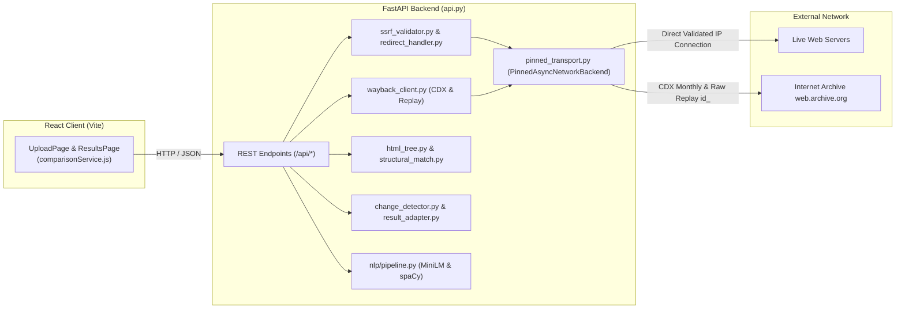

# Historical Webpage Comparison

[](https://fastapi.tiangolo.com/)
[](https://react.dev/)
[](https://www.sbert.net/)
[](./frontend/src/styles.css)
[](https://github.com/priyapandey-maker/Webpage-comparison)

A full-stack, security-hardened intelligence platform for tracking structural, textual, and semantic revisions in web pages over time. The system parses HTML into normalized Document Object Model (DOM) trees, aligns corresponding elements using a 4-component weighted similarity matcher, and applies local transformer-based Natural Language Processing to quantify semantic drift and named entity shifts across detected modifications.

---

## Complete Project Documentation Suite

For comprehensive academic, technical, demonstration, and evaluation details, consult our four dedicated guides:

| Document | Description |
| :--- | :--- |
| **[User Guide (USER_GUIDE.md)](./USER_GUIDE.md)** | Non-technical and practitioner guide covering all three comparison modes (`files`, `urls`, `wayback`), input rules, SSRF security warnings, supported website catalogue, interpreting results, and real-world examples. |
| **[Technical Documentation (TECHNICAL_DOCUMENTATION.md)](./TECHNICAL_DOCUMENTATION.md)** | Deep-dive architectural specification detailing DOM algorithms, mathematical formulas, NLP pipelines, SSRF defense, network transports, API schemas, and test evidence. |
| **[Viva & Interview Preparation (VIVA_PREPARATION.md)](./VIVA_PREPARATION.md)** | Comprehensive oral exam defense guide featuring 30s/1m/3m elevator pitches, design defenses ("Why this, not that?"), beginner glossaries, and 52 categorized viva Q&As. |
| **[Setup & Demonstration Guide (SETUP_AND_DEMO.md)](./SETUP_AND_DEMO.md)** | Step-by-step installation instructions, environment prerequisites, model downloads, test suite execution, structured demonstration catalogue, scripted flows, and troubleshooting. |

---

## Key Features

- **Three Comparison Modes**:
  1. **HTML File Upload (`files`)**: Fast, zero-network structural diffing of uploaded static `.html` files.
  2. **Live URL Comparison (`urls`)**: Concurrent streaming and comparison of two live internet web pages over hardened HTTPX transport.
  3. **Wayback Machine Integration (`wayback`)**: Automated discovery of historical captures via the Internet Archive CDX Server API with monthly collapsing (`timestamp:6`) and raw snapshot replay (`id_`).
- **DOM-Level Structural Diffing**:
  - Fault-tolerant HTML tree extraction using BeautifulSoup with `lxml`.
  - Automatic pruning of non-content elements (`<script>`, `<style>`, `<noscript>`, `<svg>`, `<canvas>`).
  - 4-component weighted bipartite matching ($0.35 \times \text{Tag} + 0.30 \times \text{Text} + 0.15 \times \text{Attributes} + 0.20 \times \text{Children}$) with soft tag matching (headings 0.7, content containers 0.45) and threshold $\ge 55$.
  - Precise classification of added, removed, and modified elements.
- **Local AI & Semantic Intelligence (Zero Cloud Dependency)**:
  - Dense 384-dimensional sentence embeddings via `sentence-transformers/all-MiniLM-L6-v2` with an in-memory embedding cache.
  - Granular semantic similarity calculated individually across matched modified text elements, aggregated into the mean cosine similarity of modifications.
  - Named Entity Recognition (NER) tracking added, removed, and shared entities via spaCy (`en_core_web_sm`) with regex-based fallback for dates, monetary values, and percentages.
  - Salient keyword and noun chunk extraction with frequency shift detection.
- **Hardened Cybersecurity & SSRF Defense**:
  - Asynchronous DNS resolution with strict IP blacklisting (RFC 1918, RFC 3927, RFC 4193, loopback, multicast, cloud metadata). Public IP literals are permitted; private/prohibited ranges are blocked.
  - DNS pinning implemented by subclassing `httpcore._backends.anyio.AnyIOBackend.connect_tcp` to connect directly to the validated IP.
  - Physical socket-level peer address inspection (`extra(SocketAttribute.remote_address)` / `getpeername()`) ensuring fail-closed protection against DNS rebinding.
  - 10 MB maximum streaming payload ceiling and 20-second connection deadline.
  - Manual redirect tracking (max 5 hops) with protocol downgrade prevention, cross-origin sensitive header stripping, and RFC 9110 method rewrites.
- **Modern Responsive User Interface**:
  - React 18 single-page dashboard built with Vite and custom CSS (`frontend/src/styles.css`).
  - Interactive overview cards, category filter tabs (`category`), side-by-side before/after diffs, and dynamic NLP insight panels.

---

## System Architecture



---

## Project Scope & Limitations

### Implemented in the Current Project
- **Three Comparison Modes**: HTML file upload (`files`), live URL comparison (`urls`), and historical Wayback comparison (`wayback`).
- **DOM / Structural Change Detection**: DOM tree building, tag pruning, and bipartite matching with weighted similarity scoring.
- **Categorized Change Reporting**: Explicit classification of additions, removals, and modifications across semantic elements (`Heading`, `Paragraph`, `Link`, `Button`, `Page title`).
- **Granular NLP Analysis of Modified Text**: Sentence Transformers (`all-MiniLM-L6-v2`) computing cosine similarity across matched modified text items, with deterministic token Jaccard fallback.
- **Entity and Keyword Dynamics**: spaCy NER identifying added, removed, and shared entities (`ORG`, `PERSON`, `GPE`, `DATE`, `MONEY`, `PERCENT`) with regex fallback, alongside noun chunk and keyword extraction.
- **SSRF-Aware Network Hardening**: Asynchronous DNS pinning using a custom `httpcore` AnyIO backend, private IP address blocking (RFC 1918, RFC 3927, loopback, cloud metadata), fail-closed socket peer verification, 10 MB payload limits, and 20s deadlines.
- **Interactive Web Interface**: Single-page React dashboard built with Vite and custom CSS (`styles.css`), backed by a Python FastAPI REST API.

### Outside Current Scope / Operational Limitations
- **No Client-Side JavaScript Execution**: The engine does not execute JavaScript. Single-Page Applications (SPAs) that require client-side execution without Server-Side Rendering (SSR) expose only initial skeleton HTML.
- **No Headless Browser Automation**: The application uses direct HTTP streaming clients; it does not drive a browser instance (such as Puppeteer, Playwright, or Selenium) for live comparison.
- **No Visual / Pixel Screenshot Diffing**: The tool tracks content and DOM hierarchy. It does not measure rendered pixel differences such as CSS animations, font smoothing, or layout positioning that do not alter DOM attributes.
- **No Recursive Domain Crawling**: The tool compares specific individual documents or URLs; it does not crawl an entire website domain recursively.
- **No Multi-Page Automated Crawling**: It operates on single-page pairs, not automated directory trees.
- **No Authentication or Cookie Sessions**: It does not support login-gated pages, paywalled content, or cookie-based sessions.
- **No Guaranteed Archive Availability**: Snapshot availability is subject to whether the Internet Archive has crawled and indexed the target page.
- **No Background Monitoring / Cron Alerting**: It performs on-demand comparisons; it does not continuously poll websites in the background for future changes.

---

### Project Scope — Presentation Summary
*(Suitable for project reports, viva slides, and formal presentations)*

> **System Overview**: Historical Webpage Comparison is a full-stack automated intelligence system that tracks structural, textual, and semantic revisions in web pages. The platform operates across three modes: offline HTML file comparison, live URL comparison, and historical Internet Archive snapshot comparison.
>
> **Core Architecture**: The engine parses raw HTML into Document Object Model trees, strips non-content tags, aligns corresponding elements using a 4-component weighted structural matcher, and calculates on-device semantic similarity using Sentence Transformers. The network layer is hardened against Server-Side Request Forgery (SSRF) and DNS rebinding attacks through asynchronous socket pinning.
>
> **Target Workload**: The application is designed for publicly accessible, server-rendered HTML pages, legal disclosures, policy documents, and archived captures. It evaluates on-demand comparisons for single-page pairs within a 10 MB streaming ceiling.
>
> **Key Distinctions**: Live comparison evaluates real-time web responses, whereas historical comparison queries Wayback CDX records. Semantic similarity is evaluated specifically across matched modified text items to detect meaning drift, rather than whole-page document classification.
>
> **Why It Is Useful**: It reduces superficial diff noise caused by whitespace, attribute ordering, and minor markup changes by matching DOM node hierarchies, helping reviewers focus on meaningful content additions, removals, and text updates.

---

### 30-Second Summary for Faculty / HOD
> "Our project is an automated webpage revision tracking platform that bridges the gap between syntactic line diffs and human semantic understanding. It takes two versions of a webpage—from local files, live URLs, or historical Wayback snapshots—builds a normalized DOM tree, and uses a weighted scoring algorithm to detect added, removed, and modified elements. For modified text, it runs an on-device Sentence Transformer to measure whether wording revisions actually changed the meaning, while our network layer mitigates SSRF and DNS rebinding risks through IP blacklisting, custom AnyIO socket pinning, and fail-closed peer-address verification. It focuses on server-rendered HTML without client-side JavaScript execution."

---

## Quick Start

### 1. Prerequisites
- **Python**: 3.10, 3.11, or 3.12 recommended (Python 3.14 lacks pre-built binary wheels for dependencies such as `lxml`).
- **Node.js**: 18.x or 20.x LTS
- **npm**: 9.x or 10.x

### 2. Backend Setup
```bash
# Navigate to backend directory
cd comparison-engine

# Create and activate virtual environment
python -m venv .venv

# Windows (PowerShell):
.\.venv\Scripts\Activate.ps1
# Linux / macOS:
# source .venv/bin/activate

# Install dependencies
pip install -r requirements.txt

# Download spaCy English model
python -m spacy download en_core_web_sm

# Start FastAPI server
uvicorn api:app --host 127.0.0.1 --port 8000 --reload
```
*API running at `http://127.0.0.1:8000` (Interactive docs: `http://127.0.0.1:8000/docs`).*

### 3. Frontend Setup
```bash
# In a new terminal, navigate to frontend directory
cd frontend

# Install Node dependencies
npm install

# Start Vite development server
npm run dev -- --host 127.0.0.1 --port 5173
```
*Frontend running at `http://127.0.0.1:5173`.*

---

## Automated Test Suite

The backend is backed by an automated test suite with **291 passing tests**:

```bash
cd comparison-engine
pytest tests/ -v
```

```text
======================= 291 passed in 19.31s =======================
```

| Component | Test File | Tests | Coverage Scope |
| :--- | :--- | :---: | :--- |
| **DOM Parsing** | `test_html_tree.py` | 5 | Tree hierarchy, tag stripping, text cleaning. |
| **Structural Matcher** | `test_structural_compare.py` | 5 | Weighted matching formula, modification thresholds. |
| **URL & SSRF Validator** | `test_security.py` / `test_url_validator.py` | 56 | Scheme validation, IP literal parsing, private IP blocks. |
| **Pinned Transport** | `test_pinned_transport.py` | 82 | SSRF blacklist, AnyIO DNS pinning, redirect controls, socket checks. |
| **NLP Engine** | `test_nlp.py` | 47 | Sentence embeddings, cosine tiers, NER regex fallback, keywords. |
| **Live Compare** | `test_live_compare.py` | 24 | Web fetching, payload boundaries, error handling. |
| **Wayback Client** | `test_wayback.py` | 48 | CDX queries, monthly snapshot collapsing, raw replay. |
| **Wayback API** | `test_api_wayback.py` | 24 | FastAPI `/api/wayback/*` route contracts, parameter validation, errors. |

---

## Repository Structure

```text
Webpage-comparison/
├── README.md                          # Project overview and entry point
├── USER_GUIDE.md                      # End-user usage guide, test catalogue & tutorials
├── TECHNICAL_DOCUMENTATION.md         # Full technical and architectural reference
├── VIVA_PREPARATION.md                # Comprehensive oral defense & Q&A guide
├── SETUP_AND_DEMO.md                  # Installation, testing & demonstration script
│
├── comparison-engine/                 # Python backend
│   ├── api.py                         # FastAPI application and route handlers (/api/*)
│   ├── result_adapter.py              # Schema adapter for frontend JSON contracts
│   ├── run_pipeline.py                # Standalone CLI pipeline runner
│   ├── requirements.txt               # Backend dependencies
│   ├── src/
│   │   ├── html_tree.py               # DOM tree construction and tag pruning
│   │   ├── structural_match.py        # Weighted 4-component node similarity scoring
│   │   ├── structural_compare.py      # Bipartite tree pairing orchestrator
│   │   ├── change_detector.py         # Semantic change categorization and node similarity
│   │   ├── live_compare.py            # Live URL fetching orchestrator
│   │   ├── wayback_client.py          # Internet Archive CDX and replay client
│   │   ├── nlp/
│   │   │   ├── pipeline.py            # NLP orchestrator over detected changes
│   │   │   ├── semantic_similarity.py # Sentence Transformers, cache & cosine math
│   │   │   ├── ner.py                 # spaCy Named Entity Recognition & regex fallback
│   │   │   ├── keyword_extraction.py  # Noun chunks, POS keywords & diffing
│   │   │   ├── model_loader.py        # Thread-safe NLP model manager
│   │   │   └── preprocessing.py       # HTML text stripping and normalization
│   │   └── security/
│   │       ├── ssrf_validator.py      # URL syntax, scheme, and IP blacklist checks
│   │       ├── redirect_handler.py    # Safe redirect loop, streaming & size limits
│   │       └── pinned_transport.py    # AnyIO network backend for DNS pinning
│   ├── tests/                         # Pytest test suite (291 tests)
│   └── examples/                      # Fixture files for testing (version1.html, version2.html)
│
└── frontend/                          # React + Vite frontend
    ├── src/
    │   ├── App.jsx                    # Root component and view state
    │   ├── main.jsx                   # React DOM entry point
    │   ├── styles.css                 # Custom CSS design system (no Tailwind)
    │   ├── services/
    │   │   └── comparisonService.js   # API client service with AbortController
    │   ├── components/
    │   │   ├── ChangeCard.jsx         # Before/after diff card component
    │   │   ├── ChangeFilters.jsx      # Category filter tab buttons
    │   │   ├── ChangeSummary.jsx      # Top metrics cards and narrative summary
    │   │   ├── ComparisonHeader.jsx   # Header showing compared version labels
    │   │   ├── FileDropZone.jsx       # Drag-and-drop HTML upload area
    │   │   └── NlpSummaryPanel.jsx    # Semantic metrics and modified text accordion
    │   ├── pages/
    │   │   ├── UploadPage.jsx         # Input forms for files, urls, and wayback
    │   │   └── ResultsPage.jsx        # Comparison dashboard and change list
    │   └── utils/
    │       ├── generateSummary.js     # Narrative text generation utility
    │       └── summary.js             # Change counting utility
    ├── package.json                   # Frontend dependencies
    └── vite.config.js                 # Vite configuration
```

---

## License

This project is developed for educational and academic research purposes.
