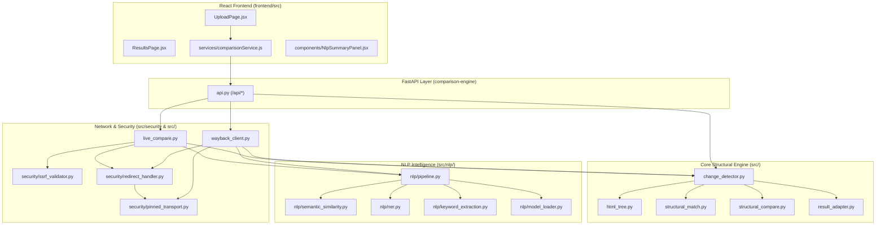

# Historical Webpage Comparison — Comprehensive Viva & Interview Preparation Guide

This document is an exhaustive, academic-grade guide designed for viva examinations, technical interviews, project presentations, and oral defenses of the **Historical Webpage Comparison** system.

---

## Table of Contents

1. [High-Level Pitch & Explanations](#1-high-level-pitch--explanations)
   - [30-Second Elevator Pitch](#30-second-elevator-pitch)
   - [1-Minute Technical Overview](#1-minute-technical-overview)
   - [3-Minute In-Depth Walkthrough](#3-minute-in-depth-walkthrough)
2. [Glossary of Core Concepts for Beginners](#2-glossary-of-core-concepts-for-beginners)
3. [Module-by-Module Codebase Breakdown](#3-module-by-module-codebase-breakdown)
4. [Design Rationale & Architectural Defense (Why This, Not That?)](#4-design-rationale--architectural-defense)
5. [52 Exhaustive Viva Questions & Model Answers](#5-52-exhaustive-viva-questions--model-answers)
   - [Category 1: Project Basics & Motivation](#category-1-project-basics--motivation)
   - [Category 2: System Architecture & Data Flow](#category-2-system-architecture--data-flow)
   - [Category 3: Backend Implementation & FastAPI Framework](#category-3-backend-implementation--fastapi-framework)
   - [Category 4: HTML Parsing & Structural Comparison Algorithms](#category-4-html-parsing--structural-comparison-algorithms)
   - [Category 5: Natural Language Processing (NLP) & Semantic Analysis](#category-5-natural-language-processing-nlp--semantic-analysis)
   - [Category 6: Live URL Fetching & Streaming Controls](#category-6-live-url-fetching--streaming-controls)
   - [Category 7: Wayback Machine Snapshot Discovery & CDX API](#category-7-wayback-machine-snapshot-discovery--cdx-api)
   - [Category 8: Cybersecurity, Network Hardening & SSRF Defense](#category-8-cybersecurity-network-hardening--ssrf-defense)
   - [Category 9: Frontend Architecture, React & State Management](#category-9-frontend-architecture-react--state-management)
   - [Category 10: Testing, Quality Assurance, Limitations & Future Work](#category-10-testing-quality-assurance-limitations--future-work)
6. [Project Scope, Operational Boundaries & Honest Limitations](#6-project-scope-operational-boundaries--honest-limitations)
   - [Implemented in the Current Project](#implemented-in-the-current-project)
   - [Outside Current Scope / Operational Limitations](#outside-current-scope--operational-limitations)
   - [Project Scope — Presentation Summary](#project-scope--presentation-summary)
   - [30-Second Summary for Faculty / HOD](#30-second-summary-for-faculty--hod)

---

## 1. High-Level Pitch & Explanations

### 30-Second Elevator Pitch
> "Historical Webpage Comparison is a full-stack, security-hardened intelligence tool that tracks how web content, layout, and meaning evolve over time. Unlike basic text diff tools that break when HTML formatting shifts, our system parses HTML into a clean Document Object Model (DOM) tree, uses a 4-component weighted structural matcher to align corresponding elements, and applies local transformer-based NLP (`all-MiniLM-L6-v2`) to quantify semantic meaning changes across detected modifications. With built-in SSRF defense and Wayback Machine integration, users can compare raw files, live URLs, or historical archive snapshots safely and accurately."

---

### 1-Minute Technical Overview
> "Traditional webpage comparison tools suffer from two major flaws: line-based diffs produce massive false positives when insignificant whitespace or attributes shift, while web-scraping utilities are notoriously vulnerable to Server-Side Request Forgery (SSRF) and DNS rebinding attacks.
> 
> Our system solves this with a two-tiered architecture:
> 1. **Robust DOM-Level Structural Comparison**: We parse HTML using BeautifulSoup with `lxml`, prune ephemeral scripts and styling, construct a normalized DOM node tree, and use a weighted scoring algorithm (tag, text, attributes, children) with soft semantic tag matching to pair matching elements across revisions. Changes are categorized into Added, Removed, and Modified with exact human-readable summaries.
> 2. **Local AI & Hardened Network Layer**: For live and historical comparisons, we run a zero-external-API NLP pipeline using Sentence Transformers and spaCy to calculate cosine semantic similarity on modified text elements, named entity shifts, and keyword dynamics. Outbound traffic is protected by subclassing `httpcore`'s AnyIO network backend to connect directly to validated IP addresses, verifying socket peer IPs, enforcing strict HTTPS-only rules for archives, streaming payload ceilings (10 MB), and blocking private IP subnets."

---

### 3-Minute In-Depth Walkthrough
> "Good morning, examiners. Today I am presenting **Historical Webpage Comparison**, an end-to-end software platform engineered to analyze structural, textual, and semantic revisions in web pages.
>
> **The Problem**: Organizations, researchers, compliance officers, and legal analysts routinely need to audit web modifications—such as tracking terms-of-service alterations, monitoring government policy statements, or auditing competitor pricing. Running standard text diffs (like `git diff`) on raw HTML is inadequate because a harmless CSS class change or tag re-ordering pollutes the diff with hundreds of false alerts. Furthermore, allowing users to supply arbitrary URLs creates critical security risks, particularly Server-Side Request Forgery (SSRF) and DNS rebinding attacks.
>
> **Our Solution Architecture**:
> We engineered a modular system consisting of a high-performance Python FastAPI backend and an interactive React/Vite frontend. The core system operates across three distinct workflows:
>
> 1. **HTML File Upload (`files`)**: Users upload two static `.html` files. The backend normalizes the markup, builds hierarchical node objects, and executes bipartite structural matching. A match score between 0 and 100 determines node correspondence (threshold 55), followed by content modification detection (threshold 70) that isolates changes in headings, paragraphs, links, buttons, and titles.
> 2. **Live URL Comparison (`urls`)**: Users submit two live web URLs. Our backend resolves the hostnames, verifies that the target does not belong to private, loopback, multicast, or cloud-metadata IP subnets, locks the socket connection to the validated IP via custom AnyIO DNS pinning, and streams the HTML with a 10 megabyte limit. After structural diffing, our NLP pipeline extracts deep insights: computing sentence embeddings on matched modified text items to determine whether the core message changed, extracting named entities (organizations, dates, monetary values), and identifying emerging keywords.
> 3. **Wayback Machine Integration (`wayback`)**: Users enter a single URL and select a historical year range. The backend queries the Internet Archive's CDX Server API (`web.archive.org/cdx/search/cdx`) using monthly collapsing (`timestamp:6`), returning up to 50 curated captures. It fetches historical HTML using raw snapshot replay endpoints (`id_` flag) to prevent the Wayback toolbar script injection from corrupting the diff.
>
> **Key Innovations & Engineering Rigor**:
> - **Security**: Our transport overrides `httpcore._backends.anyio.AnyIOBackend.connect_tcp` to connect directly to the validated IP, and checks the remote IP at the OS socket level (`SocketAttribute.remote_address` / `getpeername()`) immediately prior to HTTP header exchange, ensuring fail-closed protection against DNS rebinding.
> - **Self-Contained ML**: All models run completely on-device without external API keys or cloud dependencies.
> - **Verification**: The codebase is verified by 291 automated tests across structural parsing, network security, Wayback handling, and NLP accuracy, alongside live end-to-end browser audits."

---

## 2. Glossary of Core Concepts for Beginners

| Concept | Simple Definition | How It Is Used in This Project |
| :--- | :--- | :--- |
| **DOM (Document Object Model)** | The hierarchical tree representation of an HTML document created by web parsers. | We convert raw HTML into a structured tree of `HTMLNode` instances to navigate parents, children, and attributes. |
| **HTML Parsing** | Reading a raw HTML string and breaking it down into recognizable tags, attributes, and text nodes. | Handled via BeautifulSoup with the fast C-based `lxml` parser; strips `<script>`, `<style>`, and `<svg>`. |
| **Structural Comparison** | Comparing two trees based on tag types, hierarchical positions, and node attributes rather than raw lines of text. | Matches nodes between previous and current versions using a weighted similarity score ($\ge 55/100$). |
| **Vector Embedding** | A list of floating-point numbers (vector) that mathematically captures the semantic meaning of a passage of text. | Generated by `sentence-transformers/all-MiniLM-L6-v2` (384-dimensional dense vectors). |
| **Cosine Similarity** | A geometric metric measuring the cosine of the angle between two multi-dimensional vectors ($\in [0, 1]$ clamped). | Quantifies how similar two modified text snippets are in meaning: $1.0$ is identical, below $0.25$ indicates radical shift. |
| **Named Entity Recognition (NER)** | Identifying real-world entities such as persons, companies, locations, dates, and currency in text. | Handled by spaCy (`en_core_web_sm`) with regex-based heuristics for dates, money, and percentages. |
| **FastAPI** | A modern, asynchronous, high-performance web framework for Python based on standard type hints. | Powers our REST backend, routing `/api/compare`, `/api/compare-urls`, and `/api/wayback/*` endpoints. |
| **Async / Await** | A programming pattern that enables non-blocking asynchronous I/O operations concurrently. | Allows FastAPI and HTTPX to handle network downloads, DNS resolution, and streaming without blocking worker threads. |
| **HTTPX & httpcore** | Asynchronous HTTP client and transport libraries for Python supporting custom AnyIO network backends. | Used for all external network requests, augmented with our custom socket-pinning backend. |
| **SSRF (Server-Side Request Forgery)** | A vulnerability where an attacker tricks a backend server into making requests to private internal resources. | Blocked by validating IP ranges (RFC 1918, RFC 3927, RFC 4193, loopback, AWS metadata 169.254.169.254). |
| **DNS Rebinding / TOCTOU** | An attack where a domain resolves to a safe IP during validation, but returns a malicious private IP during connection. | Prevented via DNS Pinning: the resolved safe IP is used directly for socket creation, bypassing secondary DNS lookups. |
| **CDX Server API** | An index search API provided by the Wayback Machine listing archived captures of any URL. | We query `web.archive.org/cdx/search/cdx` using monthly collapsing (`timestamp:6`) to discover historical snapshots. |
| **Raw Snapshot Replay (`id_`)** | A Wayback Machine URL flag that serves the archived HTML exactly as it was captured, without injecting archival headers. | Used in our replay fetches (`https://web.archive.org/web/{ts}id_/{url}`) to ensure the archival banner does not corrupt comparisons. |

---

## 3. Module-by-Module Codebase Breakdown



### 1. `src/html_tree.py`
- **Purpose**: Parses raw HTML into an in-memory node hierarchy.
- **Key Operations**:
  - Uses BeautifulSoup with `lxml` parser for fault-tolerant tag extraction.
  - Recursively converts HTML elements into `HTMLNode` instances.
  - Normalizes text (collapses whitespace, trims edge padding).
  - Prunes non-content tags: `<script>`, `<style>`, `<noscript>`, `<svg>`, and `<canvas>`.
  - Computes DOM tree depth and maintains child pointer lists.

### 2. `src/structural_match.py`
- **Purpose**: Determines node-to-node correspondence between two distinct DOM trees.
- **Key Operations**:
  - Implements the 4-component weighted similarity formula:
    $$\text{Score} = \text{round}\left(100 \times \left(0.35 \cdot S_{\text{tag}} + 0.30 \cdot S_{\text{text}} + 0.15 \cdot S_{\text{attr}} + 0.20 \cdot S_{\text{children}}\right)\right)$$
  - Tag similarity ($S_{\text{tag}}$): 1.0 (exact match), 0.7 (both headings `h1`-`h6`), 0.45 (both content containers `p`, `span`, `div`, `section`, `article`), 0.0 otherwise. If 0.0, short-circuits to 0.
  - Text similarity ($S_{\text{text}}$): `SequenceMatcher.ratio()`.
  - Attribute similarity ($S_{\text{attr}}$): composite `0.4 * key_sim + 0.6 * val_sim`.
  - Children similarity ($S_{\text{children}}$): `0.7 * sequence_score + 0.3 * count_score`.
  - Applies bipartite matching with threshold $\ge 55/100$.

### 3. `src/structural_compare.py`
- **Purpose**: High-level orchestrator of structural alignment.
- **Key Operations**:
  - Flattens trees into path-based representations (e.g. `/html/body[0]/h1[0]`).
  - Calls `structural_match` to align nodes.
  - Computes structural similarity based on tags, attributes, and children.

### 4. `src/change_detector.py`
- **Purpose**: Translates matched and unmatched nodes into categorized website modifications.
- **Key Operations**:
  - Computes `node_similarity(node1, node2) = round(0.85 * text_score + 0.15 * attr_score)` using `SequenceMatcher` on sorted attribute JSON strings.
  - Evaluates changes against `MODIFICATION_THRESHOLD = 70`.
  - Identifies added, removed, modified, and unchanged nodes.

### 5. `result_adapter.py`
- **Purpose**: Normalizes output formats across backend APIs to maintain contract stability.
- **Key Operations**:
  - Consolidates complete subtree changes into high-level section records.
  - Formats output with `presentationSummary` (`total`, `added`, `removed`, `modified`) and `changes` list.
  - Identifies presentation types (`heading`, `paragraph`, `link`, `button`, `image`, `section`).

### 6. `src/security/ssrf_validator.py`
- **Purpose**: Validates and normalizes user-provided target URLs and resolves IP safety.
- **Key Operations**:
  - Restricts schemes strictly to `http` and `https`.
  - Permits public, globally routable IP literals; blocks private, loopback, link-local, multicast, and cloud metadata IPs.
  - Detects obfuscated decimal, octal, and hex IP addresses.
  - Validates hostname syntax using RFC 1123 regular expressions.

### 7. `src/security/pinned_transport.py`
- **Purpose**: Hardened asynchronous HTTPX transport preventing SSRF and DNS rebinding.
- **Key Operations**:
  - Subclasses `httpcore._backends.anyio.AnyIOBackend` (`PinnedAsyncNetworkBackend`).
  - In `connect_tcp`, resolves DNS asynchronously and connects directly to the validated safe IP address.
  - Preserves native TLS SNI and Host headers in HTTPX/httpcore.
  - Inspects socket peer address (`SocketAttribute.remote_address` / `getpeername()`) to verify the physical TCP destination matches the pinned IP (fail-closed).

### 8. `src/security/redirect_handler.py`
- **Purpose**: Safe manual redirect loop and streaming response consumer.
- **Key Operations**:
  - Implements manual redirect loop (max 5 hops) with destination re-validation.
  - Prevents HTTPS to HTTP protocol downgrades.
  - Strips sensitive headers (`Authorization`, `Cookie`, `Proxy-Authorization`) on cross-origin redirects.
  - Implements RFC 9110 method rewrites (303 converts to GET and strips body/headers; 301/302 rewrites to GET; 307/308 preserves).
  - Enforces 10 MB streaming body limit and 20.0s overall deadline.

### 9. `src/live_compare.py`
- **Purpose**: Coordinates concurrent fetching of two live web URLs and enforces HTML content invariants.
- **Key Operations**:
  - Fetches both URLs concurrently via `safe_fetch_async`.
  - Checks for HTTP 200 OK, non-empty body, and validates MIME against rejected types (`application/json`, `pdf`, images).
  - Sniffs first 2048 bytes for `<html` or `<!doctype html` if Content-Type is missing or non-standard.
  - Verifies presence of `<html>` root tag.

### 10. `src/wayback_client.py`
- **Purpose**: Client for querying the Wayback Machine CDX API and fetching raw historical snapshots.
- **Key Operations**:
  - Queries `https://web.archive.org/cdx/search/cdx` with `"collapse": "timestamp:6"` (monthly collapsing) and `"limit": "-51"`, returning up to 50 captures with truncation detection.
  - Pre-hop hostname validation strictly restricts requests to `web.archive.org` on HTTPS port 443.
  - Verifies snapshots with point queries before retrieval.
  - Fetches raw snapshots using `{timestamp}id_/{url}` to eliminate Wayback toolbar injection.
  - Rejects fallback timestamp redirects (`FallbackRedirectError` / HTTP 409).

### 11. `src/nlp/pipeline.py`, `semantic_similarity.py`, `ner.py`, `keyword_extraction.py`
- **Purpose**: Deep semantic analysis of textual changes.
- **Key Operations**:
  - `pipeline.py`: Orchestrates NLP analysis over the **detected structural changes**; computes `average_semantic_similarity` across matched modified text items.
  - `semantic_similarity.py`: Computes 384-dimensional dense vectors using `sentence-transformers/all-MiniLM-L6-v2` with an in-memory cache `_EMBEDDING_CACHE`. Computes cosine similarity clamped to $[0.0, 1.0]$.
  - `ner.py`: Extracts Named Entities using spaCy (`en_core_web_sm`) with regex-based heuristics for dates, money, and percentages. Returns `added`, `removed`, `shared`, and `by_label`.
  - `keyword_extraction.py`: Extracts noun chunks and POS tokens (`NOUN`, `PROPN`, `ADJ`, `VERB`, `NUM`), filters stop words, preserves first-seen order, and identifies added/removed terms.

### 12. `frontend/src/pages/UploadPage.jsx` & `ResultsPage.jsx`
- **Purpose**: Interactive single-page React frontend.
- **Key Operations**:
  - `UploadPage.jsx`: Tabbed navigation across `'files' | 'urls' | 'wayback'`. Features `invalidateWaybackDiscovery()` which aborts active discovery requests and resets selections on URL/year edits.
  - `ResultsPage.jsx`: Renders change summary cards, dynamic badges, category filter tabs (`change.category`), collapsible diff cards, and conditional `<NlpSummaryPanel />`.

---

## 4. Design Rationale & Architectural Defense

During your viva, examiners frequently challenge design choices. Here is how to defend your architectural decisions:

### Defense 1: Why DOM-level tree matching instead of raw text diffing (`git diff` or Levenshtein)?
- **The Challenge**: *"Why not simply run standard `diff` or calculate string edit distance between two HTML files?"*
- **Our Defense**:
  > "Raw text diff tools operate on lines of characters without understanding syntax. In HTML, formatting changes (such as adding spaces, reordering tag attributes, or wrapping text in a non-visual `<span>`) produce dozens of false-positive diff lines while the visual page remains unchanged. Conversely, meaningful changes can be buried inside large diff chunks. By parsing HTML into a Document Object Model (DOM) tree, our engine decouples layout structure from presentation, eliminates script/style noise, and tracks the exact identity of buttons, links, headings, and paragraphs."

### Defense 2: Why BeautifulSoup with `lxml` instead of regex or a headless browser (Puppeteer/Selenium)?
- **The Challenge**: *"Why didn't you use regular expressions or run a headless browser like Chrome/Playwright?"*
- **Our Defense**:
  > "Regular expressions cannot parse arbitrary HTML because HTML is a context-free grammar with arbitrarily nested tags. On the other end, headless browsers introduce massive resource overhead (requiring hundreds of megabytes of RAM per browser instance), slow execution speeds, and complex driver dependencies that make automated API scaling impractical. BeautifulSoup backed by `lxml` provides a C-accelerated, fault-tolerant parser capable of processing damaged or malformed real-world HTML in milliseconds while maintaining low memory consumption."

### Defense 3: Why local Sentence Transformers (`all-MiniLM-L6-v2`) instead of OpenAI's GPT-4 API or TF-IDF?
- **The Challenge**: *"Why use a local PyTorch transformer model instead of calling a commercial LLM API or using simple TF-IDF word vectors?"*
- **Our Defense**:
  > "Traditional TF-IDF only matches exact lexical vocabulary—it fails to understand synonyms (e.g., 'price increased' vs 'cost went up'). Commercial LLM APIs introduce external network latency, billing costs, quota rate limits, and serious data privacy risks (sending internal or sensitive customer URLs to third-party cloud servers). `all-MiniLM-L6-v2` runs locally on the CPU in under 50 milliseconds, produces high-quality 384-dimensional dense semantic vectors, requires zero API keys, and operates completely offline with deterministic output."

### Defense 4: Why FastAPI instead of Flask or Django?
- **The Challenge**: *"Why did you select FastAPI over well-established frameworks like Flask or Django?"*
- **Our Defense**:
  > "FastAPI is natively built on ASGI (`Starlette` and `uvicorn`) with first-class Python asynchronous `async`/`await` support. This allows our backend to handle long-running I/O-bound operations (such as resolving DNS, streaming live URLs, and querying Wayback CDX APIs) concurrently without blocking server worker threads. Furthermore, FastAPI leverages Pydantic for automated data validation, strict type enforcement, and automatic OpenAPI/Swagger documentation generation."

### Defense 5: Why custom socket-level DNS pinning instead of standard `requests.get()`?
- **The Challenge**: *"Why build a complex custom network backend instead of using Python's standard `requests` library?"*
- **Our Defense**:
  > "Standard libraries like `requests` or default `httpx` are fundamentally insecure when accepting arbitrary user-supplied URLs. Attackers can exploit Server-Side Request Forgery (SSRF) using DNS rebinding: configuring a public domain whose DNS returns a public IP during initial validation, but a private IP (e.g., `127.0.0.1` or `169.254.169.254` AWS metadata) milliseconds later when the HTTP client connects. Our custom `PinnedAsyncNetworkBackend` subclasses `httpcore`'s AnyIO backend; in `connect_tcp`, it resolves DNS asynchronously, validates the IP against prohibited ranges, and establishes the TCP connection directly to that validated safe IP address. Then it inspects `SocketAttribute.remote_address` on the active connection. This guarantees complete immunity against DNS rebinding while allowing HTTPX to naturally handle TLS SNI and Host headers."

### Defense 6: Why use the `id_` flag in Wayback Machine replay URLs?
- **The Challenge**: *"What is the significance of the `id_` modifier when fetching historical snapshots from web.archive.org?"*
- **Our Defense**:
  > "When the Internet Archive serves a standard replay page (e.g., `web.archive.org/web/{ts}/{url}`), it injects an interactive JavaScript banner, navigation toolbar, and analytics scripts directly into the HTML DOM. If our comparison engine compared this altered HTML, it would report dozens of phantom changes belonging to the Wayback toolbar rather than the historical website. Appending `id_` (e.g., `web.archive.org/web/{ts}id_/{url}`) instructs the Wayback server to return raw, unmodified archived HTML."

---

## 5. 52 Exhaustive Viva Questions & Model Answers

### Category 1: Project Basics & Motivation

#### Q1. What is the core problem that this project addresses?
> **Answer**: Organizations and individuals need to track modifications on web pages across time for legal auditing, compliance, policy tracking, and competitor analysis. Existing tools either rely on raw text diffing (which breaks with minor HTML layout changes) or lack automated historical retrieval. Our project provides an intelligent, automated, and secure system that performs structural and semantic comparison across local files, live websites, and Wayback Machine archives.

#### Q2. Who are the primary intended users of this application?
> **Answer**:
> 1. **Compliance & Legal Officers**: Auditing revisions in Privacy Policies, Terms of Service, and regulatory disclosures.
> 2. **Journalists & Fact-Checkers**: Monitoring shifts in political statements, corporate claims, or news reporting.
> 3. **Cybersecurity Analysts**: Tracking unauthorized defacements, phishing template updates, or unexpected website modifications.
> 4. **SEO & Product Managers**: Monitoring competitor pricing, product feature descriptions, and page layout updates.

#### Q3. What are the three comparison modes supported by the system?
> **Answer**:
> 1. **Upload HTML Files (`files`)**: Directly compares two uploaded static `.html` files offline.
> 2. **Live URL Comparison (`urls`)**: Fetches and compares two live web addresses across the internet, enhanced with full NLP semantic analysis.
> 3. **Wayback Historical Comparison (`wayback`)**: Discovers and compares two historical monthly snapshots of a single URL retrieved from the Internet Archive.

#### Q4. Why is raw line-by-line diffing inadequate for HTML comparison?
> **Answer**: HTML is a tree-structured markup language where whitespace, attribute ordering, and indentation are semantically meaningless to browser rendering. A line diff treats `class="a b"` and `class="b a"`, or re-indented nested tags, as deleted and added lines, creating massive visual noise. DOM-based comparison parses tags into structured nodes, ignoring syntactic whitespace and comparing actual element semantics.

#### Q5. What is the role of NLP in web comparison, and what does it analyze?
> **Answer**: Structural comparison identifies *which* elements changed (e.g., "Heading updated from A to B"). The NLP pipeline operates over the **detected structural changes** to assess the semantic impact of those modifications: calculating sentence embeddings on modified text items to determine whether the core message changed, extracting named entities (people, companies, monetary figures) that were added, removed, or retained, and identifying emerging keywords. The top-level score is the **mean cosine similarity across matched modified text items**.

---

### Category 2: System Architecture & Data Flow

#### Q6. Describe the high-level architecture of the system.
> **Answer**: The system follows a decoupled client-server architecture:
> - **Frontend**: A React single-page application built with Vite and custom CSS (`styles.css`), utilizing an API abstraction layer (`services/comparisonService.js`) with native `fetch` and `AbortController`.
> - **Backend**: A Python FastAPI REST service exposing clean endpoints under the `/api` prefix (`/api/compare`, `/api/compare-urls`, `/api/wayback/snapshots`, `/api/wayback/compare`, `/api/health`).
> - **Core Engine**: HTML tree extraction (`html_tree.py`), weighted structural matching (`structural_match.py`), change detection (`change_detector.py`), and result adaptation (`result_adapter.py`).
> - **Security & Network Layer**: An asynchronous DNS-pinned transport layer (`pinned_transport.py`), SSRF validator (`ssrf_validator.py`), and safe redirect handler (`redirect_handler.py`).
> - **NLP Engine**: Sentence Transformers (`all-MiniLM-L6-v2`) and spaCy (`en_core_web_sm`) pipeline running locally on the CPU.

#### Q7. Trace the end-to-end data flow when a user compares two live URLs.
> **Answer**:
> 1. User inputs URL 1 and URL 2 on `UploadPage.jsx` and clicks "Compare Live URLs".
> 2. Frontend validates URL syntax and dispatches an HTTP POST request to `/api/compare-urls`.
> 3. FastAPI route handler delegates to `live_compare.py`.
> 4. `PinnedAsyncNetworkBackend` resolves DNS asynchronously, checks against blacklisted subnets, creates TCP sockets directly to the validated IP, and streams up to 10 MB of HTML for each URL.
> 5. `html_tree.py` parses both HTML strings, prunes scripts/styles, and builds DOM node hierarchies.
> 6. `structural_match.py` computes bipartite similarity scores to align matching elements.
> 7. `change_detector.py` categorizes additions, removals, and modifications across headings, paragraphs, links, and buttons.
> 8. `nlp/pipeline.py` extracts text from matched modified changes, computes sentence embeddings, calculates cosine similarity, extracts entities, and derives keywords.
> 9. Results are assembled into a camelCase JSON payload via `result_adapter.py` and returned to the frontend.
> 10. `ResultsPage.jsx` renders summary metrics, NLP insight panels, and filterable change cards.

#### Q8. How does the system handle state management across the three modes in the frontend?
> **Answer**: In `UploadPage.jsx`, mode selection is managed via active tab state (`'files' | 'urls' | 'wayback'`). Each mode maintains isolated state variables (e.g., `version1File`/`version2File`, `url1`/`url2`, `waybackUrl`/`fromYear`/`toYear`). Switching tabs does not trigger unwanted network calls. In addition, modifying `waybackUrl`, `fromYear`, or `toYear` calls `invalidateWaybackDiscovery()`, which increments a sequence ref, aborts active requests via `discoveryAbortControllerRef`, and resets snapshot dropdown selections to prevent state contamination.

---

### Category 3: Backend Implementation & FastAPI Framework

#### Q9. Why was FastAPI selected instead of traditional frameworks like Django or Flask?
> **Answer**: FastAPI provides native asynchronous concurrency via `async`/`await` on top of Starlette and Uvicorn. Since web fetching and CDX queries are I/O-bound operations, FastAPI can handle multiple concurrent requests without thread starvation. Additionally, FastAPI provides automatic request body validation using Pydantic models and generates interactive OpenAPI documentation out of the box.

#### Q10. What endpoints does the backend expose?
> **Answer**: All endpoints reside under the `/api` route prefix:
> - `GET /api/health`: Healthcheck endpoint returning `{"status": "ok"}`.
> - `POST /api/compare`: Accepts two multipart form-data HTML files; returns structural comparison.
> - `POST /api/compare-urls`: Accepts two JSON URLs; fetches web pages, executes structural diff and NLP analysis.
> - `GET /api/wayback/snapshots`: Accepts `url`, `from_year`, and `to_year`; queries CDX API with monthly collapsing and returns snapshot options.
> - `POST /api/wayback/compare`: Accepts `url`, `timestamp1`, and `timestamp2`; downloads historical snapshots, executes structural diff and NLP analysis.

#### Q11. How does FastAPI validate incoming request payloads?
> **Answer**: We define Pydantic schema models such as `CompareURLsPayload` and `WaybackComparePayload`, alongside domain models `CompareURLsRequest`, `WaybackSnapshotsRequest`, and `WaybackCompareRequest`. Pydantic automatically validates field types, checks URL formats, validates 14-digit timestamp strings, and enforces required fields, returning HTTP 400 or 422 with descriptive error messages if validation fails.

#### Q12. How does the backend communicate errors to the frontend?
> **Answer**: All errors are raised as structured `HTTPException` instances with appropriate status codes:
> - `400 Bad Request`: Malformed URLs, embedded user credentials, private IP addresses (SSRF), or inverted year bounds.
> - `404 Not Found`: No Wayback snapshots found for the specified URL and timestamp.
> - `409 Conflict`: Wayback snapshot replay redirect mismatch (`FallbackRedirectError`).
> - `413 Payload Too Large`: Response body exceeded 10 MB limit.
> - `415 Unsupported Media Type`: Non-HTML content-type (JSON, PDF, image).
> - `422 Unprocessable Entity`: Document is empty, missing `<html>` root, or failed snapshot verification.
> - `502 Bad Gateway`: Remote server unreachable or unauthorized off-host redirect.
> - `504 Gateway Timeout`: Exceeded 20-second streaming deadline.

---

### Category 4: HTML Parsing & Structural Comparison Algorithms

#### Q13. How does `html_tree.py` represent the parsed HTML?
> **Answer**: It defines an `HTMLNode` dataclass containing:
> - `tag`: Element tag name (e.g., `p`, `h1`, `div`).
> - `attributes`: Dictionary of HTML attributes (e.g., `class`, `href`, `id`).
> - `text`: Normalized visible text content of the element.
> - `children`: List of child `HTMLNode` instances.
> - `parent`: Weak reference to parent node.
> - `depth`: Integer depth within the DOM tree.

#### Q14. What elements are pruned during HTML tree construction and why?
> **Answer**: Elements like `<script>`, `<style>`, `<noscript>`, `<svg>`, `<canvas>`, and `<template>` are stripped. These elements contain executable code, styling rules, or complex vector data that do not represent visible semantic web content. Pruning them significantly speeds up processing and prevents false-positive code diffs.

#### Q15. Explain the mathematical formula used in `structural_match.py`.
> **Answer**: The node similarity score (0 to 100) is defined as:
> $$\text{Score} = \text{round}\left(100 \times \left(w_1 S_{\text{tag}} + w_2 S_{\text{text}} + w_3 S_{\text{attr}} + w_4 S_{\text{children}}\right)\right)$$
> Where:
> - $w_1 = 0.35$: Tag similarity ($1.0$ exact match, $0.7$ both headings `h1`–`h6`, $0.45$ both content containers `p`, `span`, `div`, `section`, `article`, $0.0$ otherwise). If $S_{\text{tag}} = 0$, the function returns $0$ immediately.
> - $w_2 = 0.30$: Text similarity using `SequenceMatcher.ratio()`.
> - $w_3 = 0.15$: Attribute similarity ($0.4 \times \text{KeyJaccard} + 0.6 \times \text{ValSim}$).
> - $w_4 = 0.20$: Children similarity ($0.7 \times \text{SequenceScore} + 0.3 \times \text{CountScore}$).

#### Q16. What is the `MATCH_THRESHOLD` and why is it set to 55?
> **Answer**: `MATCH_THRESHOLD = 55`. If the weighted similarity score between two nodes is $\ge 55$, they are treated as candidate structural matches. Extensive testing revealed that a threshold below 50 causes false pairings between unrelated elements with similar short text, whereas a threshold above 65 causes modified elements (e.g., a rewritten paragraph) to be misclassified as a deletion and insertion.

#### Q17. How does the system distinguish between a "Modification" and an "Addition/Removal"?
> **Answer**: After candidate matching, `change_detector.py` evaluates nodes using:
> $$\text{NodeSim} = \text{round}\left(0.85 \cdot \text{TextScore} + 0.15 \cdot \text{AttrScore}\right)$$
> If $\text{NodeSim} \ge 70$ (`MODIFICATION_THRESHOLD = 70`), or if critical attributes (such as `href` on `<a>` or `src` on ``) have changed, the element is categorized as **Modified**. Unmatched nodes in Version 1 are categorized as **Removed**, and unmatched nodes in Version 2 are categorized as **Added**.

#### Q18. How does `change_detector.py` filter out wrapper noise?
> **Answer**: Generic structural containers like `<div>`, `<section>`, `<article>`, and `<span>` often shift without any user-perceptible change. `change_detector.py` filters for semantically meaningful elements: `<title>`, `<h1>`-`<h6>`, `<p>`, `<a>`, `<button>`, `<li>`, and `<input>`. A `<div>` modification is only reported if it directly holds leaf text that changed, and `result_adapter.py` consolidates entire added/removed subtrees into single high-level section entries.

---

### Category 5: Natural Language Processing (NLP) & Semantic Analysis

#### Q19. What specific NLP model is used for semantic similarity, and what is its architecture?
> **Answer**: We use `sentence-transformers/all-MiniLM-L6-v2`. It is a 6-layer MiniLM transformer model fine-tuned on over 1 billion sentence pairs for semantic similarity. It maps sentences into a dense 384-dimensional vector space where semantically similar texts have high cosine similarity. Computed vectors are cached in an in-memory dictionary `_EMBEDDING_CACHE` keyed by `(id(model), model_name, text)`.

#### Q20. Write down the mathematical definition of Cosine Similarity and explain how its value is interpreted.
> **Answer**:
> $$S_C(\mathbf{u}, \mathbf{v}) = \frac{\mathbf{u} \cdot \mathbf{v}}{\|\mathbf{u}\|_2 \|\mathbf{v}\|_2} = \frac{\sum_{k=1}^{384} u_k v_k}{\sqrt{\sum_{k=1}^{384} u_k^2} \sqrt{\sum_{k=1}^{384} v_k^2}}$$
> Where $\mathbf{u}$ and $\mathbf{v}$ are 384-dimensional embedding vectors. The raw score is clamped to $[0.0, 1.0]$ and rounded to 4 decimals.
> Interpretation & UI Labels:
> - $S_C \ge 0.999$: **Identical ($\ge 99.9\%$)** (no perceptible semantic shift)
> - $0.80 \le S_C < 0.999$: **High Overlap ($80–99\%$)** (minor edits or stylistic rephrasing)
> - $0.50 \le S_C < 0.80$: **Moderate Shift ($50–79\%$)** (noticeable updates or topic expansion)
> - $0.25 \le S_C < 0.50$: **Substantial Shift ($25–49\%$)** (major revisions with low semantic overlap)
> - $S_C < 0.25$: **Different ($< 25\%$)** (completely changed content)

#### Q21. What happens if PyTorch or Sentence Transformers is unavailable in the environment?
> **Answer**: The system implements an automatic, graceful fallback: `compute_fallback_similarity()`. It tokenizes both documents into lowercase words, splits on whitespace, and computes token Jaccard similarity:
> $$J(T_1, T_2) = \frac{|T_1 \cap T_2|}{|T_1 \cup T_2|}$$
> This ensures the application never crashes even in restricted or low-memory runtime environments.

#### Q22. How does the system extract Named Entities, and what is the fallback?
> **Answer**: We use spaCy's `en_core_web_sm` model to perform Named Entity Recognition (NER), identifying categories such as `ORG`, `PERSON`, `GPE`, `DATE`, `MONEY`, and `PERCENT`. The comparison identifies `added`, `removed`, and `shared` entities. If spaCy is missing or has no trained NER pipeline, the system triggers `extract_entities_fallback`, which uses compiled regex patterns to extract dates (month names and 4-digit years), monetary figures, and percentages.

#### Q23. How are keywords extracted and tracked?
> **Answer**: `nlp/keyword_extraction.py` first extracts noun chunks using spaCy's dependency parser and strips leading stop words. It then extracts individual tokens with POS tags in `{"NOUN", "PROPN", "ADJ", "VERB", "NUM"}`. It filters out standard English stop words, enforces a minimum length of 3 characters (`min_length = 3`), preserves 4-digit years, and deduplicates case-insensitively while preserving **first-seen document order**. It returns `added`, `removed`, and `shared` keyword lists.

---

### Category 6: Live URL Fetching & Streaming Controls

#### Q24. What are the main hazards when building a feature that fetches user-submitted URLs?
> **Answer**:
> 1. **Server-Side Request Forgery (SSRF)**: Attackers submitting loopback or cloud metadata URLs (`http://169.254.169.254`) to steal cloud credentials.
> 2. **Denial of Service (DoS)**: Downloading gigabyte-sized files (zip bombs, ISO images) leading to server memory exhaustion.
> 3. **Slowloris / Hanging Connections**: Malicious servers holding connections open indefinitely, consuming worker threads.
> 4. **DNS Rebinding Attacks**: Fast-flux DNS switching to private IPs after validation.

#### Q25. How does the system limit response body sizes?
> **Answer**: We implement a hard streaming ceiling of 10 Megabytes (`DEFAULT_MAX_RESPONSE_SIZE = 10 * 1024 * 1024`). The HTTP client streams chunks of data (`response.aiter_bytes()`). As chunks arrive, a running byte counter is incremented. If the counter exceeds 10 MB, or if the `Content-Length` header exceeds 10 MB, the connection is instantly aborted and an HTTP 413 Payload Too Large error is returned.

#### Q26. What timeouts are enforced during live fetches?
> **Answer**: We enforce a strict 20-second overall timeout (`DEFAULT_TOTAL_DEADLINE = 20.0`) encompassing connect, read, write, and all redirect hops. If a target server stalls or delays response headers, the request is cleanly terminated with an HTTP 504 Gateway Timeout error.

#### Q27. How are HTTP redirects handled safely?
> **Answer**: Standard automatic redirect following is explicitly disabled (`follow_redirects=False`). Our system handles redirects manually in a loop with strict constraints:
> - Maximum of 5 redirect hops (`DEFAULT_MAX_REDIRECTS = 5`).
> - Every redirect URL is re-validated through the full URL validator and IP blacklist.
> - Protocol downgrades (redirecting from HTTPS to HTTP) are strictly forbidden.
> - Cross-origin redirects automatically strip sensitive authorization headers (`Authorization`, `Cookie`, `Proxy-Authorization`).
> - Implements RFC 9110 method transformations: status 303 converts method to GET and discards body/headers; status 301/302 rewrites non-GET to GET; status 307/308 preserves method and body.

---

### Category 7: Wayback Machine Snapshot Discovery & CDX API

#### Q28. What is the Internet Archive CDX Server API?
> **Answer**: The CDX Server is a public query interface (`https://web.archive.org/cdx/search/cdx`) provided by the Internet Archive. It indexes billions of web captures and returns metadata including capture timestamp (14-digit format `YYYYMMDDhhmmss`), original URL, HTTP status code, MIME type, and cryptographic content SHA-1 digest.

#### Q29. How does our backend query the CDX API?
> **Answer**: In `wayback_client.py`, `discover_wayback_snapshots` dispatches an asynchronous GET request to the CDX API with parameters:
> ```python
> params = {
>     "url": request.url,
>     "output": "json",
>     "fl": "timestamp,original,mimetype,statuscode,length",
>     "filter": ["statuscode:200", "mimetype:text/html"],
>     "collapse": "timestamp:6",
>     "limit": "-51",
> }
> ```
> This queries only successful HTML captures (HTTP 200) with **monthly collapsing** (`timestamp:6`), requesting the latest 51 captures to detect truncation while returning at most 50 captures.

#### Q30. Why is monthly collapsing (`timestamp:6`) used?
> **Answer**: High-traffic websites can have tens of thousands of snapshots captured in a single year. By specifying `"collapse": "timestamp:6"`, the CDX API groups captures by year and month (`YYYYMM`), returning at most one snapshot per month. This provides a clean, manageable selection of up to 50 historical captures across the user's requested year bounds without overwhelming the user interface.

#### Q31. What is the format of a Wayback timestamp?
> **Answer**: It is a 14-digit UTC string formatted as `YYYYMMDDhhmmss` (e.g., `20210515123045` corresponds to May 15, 2021, at 12:30:45 UTC). The frontend parses this string into human-readable date and time formats.

#### Q32. What is `FallbackRedirectError` (HTTP 409) in `wayback_client.py`?
> **Answer**: When querying specific older snapshots, the Wayback replay service occasionally redirects to a different timestamp if the requested snapshot is missing or corrupted. If the server redirects to a snapshot that deviates from the user's chosen timestamp, our client halts and raises `FallbackRedirectError` (HTTP 409 Conflict), notifying the user that the exact historical state requested could not be faithfully retrieved.

---

### Category 8: Cybersecurity, Network Hardening & SSRF Defense

#### Q33. What is Server-Side Request Forgery (SSRF)?
> **Answer**: SSRF is a security vulnerability that occurs when a web application fetches a remote resource without properly validating the destination address. An attacker can supply internal URLs (e.g., `http://localhost:8080/admin` or `http://169.254.169.254/latest/meta-data/`) to access private microservices, cloud credentials, or intranet infrastructure behind the firewall.

#### Q34. What IP ranges are blocked by `ssrf_validator.py`?
> **Answer**:
> - **Loopback Addresses**: `127.0.0.0/8`, `::1/128`
> - **Private RFC 1918**: `10.0.0.0/8`, `172.16.0.0/12`, `192.168.0.0/16`
> - **Link-Local & Cloud Metadata (RFC 3927)**: `169.254.0.0/16`, `fe80::/10`
> - **Unique Local IPv6 (RFC 4193)**: `fc00::/7`
> - **Shared Address Space (RFC 6598)**: `100.64.0.0/10`
> - **Multicast & Reserved**: `224.0.0.0/4`, `240.0.0.0/4`, `ff00::/8`
> - **Broadcast / Current Network**: `0.0.0.0/8`, `::/128`

#### Q35. Explain DNS Rebinding and how Time-of-Check to Time-of-Use (TOCTOU) occurs.
> **Answer**: In naive SSRF protection:
> 1. *Time of Check*: The server resolves `attacker.com` to `93.184.216.34` (public IP) and approves it.
> 2. *Time of Use*: The HTTP client calls `requests.get('http://attacker.com')`. The underlying OS performs a *second* DNS lookup. The attacker's authoritative DNS server, having configured a TTL of 0 seconds, now responds with `127.0.0.1`. The server connects to its own loopback interface.
> This separation between validation check and execution use is a classic TOCTOU vulnerability.

#### Q36. How does DNS Pinning in `PinnedAsyncNetworkBackend` completely neutralize DNS rebinding?
> **Answer**:
> 1. The transport subclasses `httpcore._backends.anyio.AnyIOBackend.connect_tcp`.
> 2. In `connect_tcp`, it resolves DNS asynchronously and validates the IP against blacklisted ranges.
> 3. It establishes the TCP socket connection directly to that validated IP address (`super().connect_tcp(host=pinned_ip, port=port)`).
> 4. HTTPX and `httpcore` manage TLS SNI and Host headers natively using the original URL hostname.
> 5. Prior to sending any data, we call `raw_stream.extra(anyio.abc.SocketAttribute.remote_address)` on the active socket to verify that the remote endpoint actually matches the pinned safe IP (fail-closed).
> Because the operating system never executes a second DNS lookup, DNS rebinding is rendered physically impossible.

#### Q37. Are IP literals accepted in URLs?
> **Answer**: Yes, **public, globally routable IP literals are permitted** (e.g., `http://93.184.216.34`). They are parsed directly by `ipaddress.ip_address()` without requiring a DNS lookup. Only IP literals that fall into private, loopback, link-local, multicast, or cloud metadata ranges are rejected.

---

### Category 9: Frontend Architecture, React & State Management

#### Q38. What modern frontend stack is used, and why?
> **Answer**: React 18 with Vite and pure custom CSS (`frontend/src/styles.css`).
> - **Vite**: Provides instant Hot Module Replacement (HMR) and optimized Rollup production builds.
> - **React 18**: Provides efficient virtual DOM rendering and predictable component lifecycles.
> - **Custom CSS**: Enables clean, maintainable BEM-style classes without the dependency overhead of Tailwind CSS.

#### Q39. How is the UI partitioned into components?
> **Answer**:
> - `App.jsx`: Top-level router and state container holding the comparison result.
> - `UploadPage.jsx`: Main input container managing tabs (`files`, `urls`, `wayback`), form validation, and snapshot discovery.
> - `ResultsPage.jsx`: Top-level results view rendering overview statistics, category filters (`change.category`), and diff items.
> - `NlpSummaryPanel.jsx`: Dedicated visualization panel displaying semantic badges, cosine metric value, similarity distribution cards, entity tags, and keyword shifts.
> - `ComparisonHeader.jsx`, `ChangeSummary.jsx`, `ChangeFilters.jsx`, `ChangeCard.jsx`, `FileDropZone.jsx`.

#### Q40. How does the frontend handle loading states and prevent double submissions?
> **Answer**: When a submission begins, `isLoading` state is set to `true`, disabling the submit button and rendering animated loading spinners. We instantiate an `AbortController` passed to `services/comparisonService.js`. If the user navigates away or cancels, the network request is immediately aborted on the client side.

#### Q41. How does `ResultsPage.jsx` gracefully handle the absence of NLP data in Mode 1?
> **Answer**: Mode 1 (HTML file upload) runs purely local structural diffing and does not execute the NLP pipeline. `ResultsPage.jsx` checks `const hasNlp = Boolean(comparison?.nlpAnalysis)`. If `hasNlp` is false, `<NlpSummaryPanel />` is completely unmounted, and the numbered section headers dynamically adjust from `01 Change Overview -> 02 Detected Changes` instead of showing empty placeholders.

#### Q42. Explain how the filter tabs work on `ResultsPage.jsx`.
> **Answer**: The results view maintains an active filter state (`'all' | 'added' | 'removed' | 'modified'`). Change items are filtered in memory:
> ```javascript
> const visibleChanges = activeFilter === 'all'
>   ? changes
>   : changes.filter((change) => change.category === activeFilter);
> ```
> Each tab badge dynamically displays the count for that specific category.

---

### Category 10: Testing, Quality Assurance, Limitations & Future Work

#### Q43. What is the scope and breakdown of the automated test suite?
> **Answer**: The backend suite contains **291 automated tests** executing in under 20 seconds:
> - **Core Comparison & HTML Parsing (`test_structural_compare.py`, `test_html_tree.py`)**: 10 tests verifying node extraction, weighted scoring, and threshold boundary conditions.
> - **Network Security & URL Validation (`test_security.py`, `test_pinned_transport.py`)**: 138 tests verifying private IP subnets, IPv6 formats, redirect limits, scheme restrictions, and DNS pinning.
> - **NLP Pipeline (`test_nlp.py`)**: 47 tests verifying semantic embeddings, cosine similarity tier mapping, NER regex fallback, and keyword frequency.
> - **Live Comparison (`test_live_compare.py`)**: 24 tests verifying live URL fetching, HTML processing, and end-to-end integration.
> - **Wayback Integration (`test_wayback.py`, `test_api_wayback.py`)**: 72 tests (48 client + 24 API) verifying CDX monthly collapsing, snapshot point verification, fallback redirects, and replay response handling.

#### Q44. How were real browser tests conducted?
> **Answer**: All three modes were audited in an active Chrome browser session:
> 1. Mode 1 was verified using original Phase 1 fixtures (`version1.html` and `version2.html`), confirming exact counts: 5 changes (1 added button, 4 modifications: link, heading, paragraph, title).
> 2. Mode 2 was verified comparing `example.com` against `iana.org/domains/reserved`, confirming loading spinners, structural diffs, and the NLP panel.
> 3. Mode 3 was verified discovering snapshots for `iana.org` across 2022–2023 and comparing historical captures.

#### Q45. What are the key limitations of the current implementation?
> **Answer**:
> 1. **No JavaScript Execution**: The engine fetches static raw HTML. Client-rendered Single-Page Applications (React/Vue/Angular without SSR) that rely on client-side JS rendering will only expose skeleton HTML.
> 2. **No Visual / Pixel Diffing**: The tool inspects DOM structure and semantics, not rendered pixel screenshots. A pure CSS color change without an attribute or text change will not be flagged as a structural difference.
> 3. **Single-Page Scope**: It compares individual URLs or files, not recursive multi-page website trees.
> 4. **Third-Party Rate Limits**: Wayback Machine CDX API availability is subject to Internet Archive server health and rate limiting.

#### Q46. If you had another month to work on this project, what features would you add?
> **Answer**:
> 1. **Headless Browser Rendering**: Integrate optional Playwright rendering for client-side SPAs.
> 2. **Visual Screenshot Diffing**: Render full-page screenshots and perform pixel-level perceptual diffing alongside DOM diffing.
> 3. **Scheduled Automated Monitoring**: Implement cron-based monitoring that periodically checks a target URL and sends alert notifications when semantic similarity drops below a threshold.
> 4. **Export Options**: Add one-click PDF, CSV, and JSON report downloads from the frontend.

#### Q47. How would you scale this application to handle thousands of comparisons per minute?
> **Answer**:
> 1. **Decouple NLP via Worker Queues**: Heavy PyTorch inference should be moved from the web server into Celery or RQ background worker pools backed by Redis or RabbitMQ.
> 2. **Cache Historical Snapshots**: Archived snapshots are immutable. Once fetched, their parsed DOM trees and NLP embeddings should be cached in Redis or PostgreSQL, avoiding redundant CDX calls and model evaluations.
> 3. **Containerization & Horizontal Autoscaling**: Package FastAPI into Docker containers deployed across a Kubernetes cluster behind an NGINX ingress with autoscaling based on CPU/GPU utilization.

#### Q48. What is the time complexity of the structural matching algorithm?
> **Answer**: If tree 1 has $N$ nodes and tree 2 has $M$ nodes, a naive all-pairs comparison is $O(N \cdot M)$. Our implementation optimizes this by pruning non-content wrapper tags and filtering candidates by tag identity and tree depth, achieving near $O(N \log M)$ average-case performance on standard web pages.

#### Q49. What is the difference between Jaccard similarity and Cosine similarity in this project?
> **Answer**:
> - **Jaccard Similarity** operates on discrete sets: $J(A, B) = \frac{|A \cap B|}{|A \cup B|}$. We use it in structural matching to compare attribute keys and values, and as an NLP fallback for word tokens.
> - **Cosine Similarity** operates on continuous vectors in high-dimensional space: $S_C(\mathbf{u}, \mathbf{v}) = \frac{\mathbf{u} \cdot \mathbf{v}}{\|\mathbf{u}\|_2 \|\mathbf{v}\|_2}$. We use it on 384-dimensional dense neural embeddings to capture abstract conceptual meaning.

#### Q50. Can an attacker bypass the SSRF protection using an IPv6 address?
> **Answer**: No. `ssrf_validator.py` and `pinned_transport.py` parse IPv6 addresses using Python's `ipaddress` library, which normalizes compressed notations (e.g., `::1`, `0:0:0:0:0:0:0:1`). Our blacklist blocks loopback (`::1/128`), unspecified (`::/128`), unique local (`fc00::/7`), and link-local (`fe80::/10`). Sockets explicitly enforce family boundaries across both `AF_INET` and `AF_INET6`.

#### Q51. What happens if a target website returns an HTTP 500 or 404 status code during a live comparison?
> **Answer**: `live_compare.py` checks `result.status_code`. If the server returns a non-200 code, an informative `LiveFetchError(f"URL returned HTTP status {status_code} (expected 200 OK)")` is raised and mapped in `api.py` to HTTP 502, preventing corrupted or incomplete HTML from reaching the comparison engine.

#### Q52. Why does Mode 1 not execute the NLP pipeline?
> **Answer**: Mode 1 was designed in Phase 1 as an ultra-fast, lightweight, offline comparison tool for local HTML documents. Running heavy transformer models on local files would introduce unnecessary latency when users only require structural change inspection. However, the architecture is modular, and invoking the NLP pipeline on Mode 1 would only require adding one function call in `api.py`.

---

## 6. Project Scope, Operational Boundaries & Honest Limitations

For academic integrity, always state project capabilities and operational boundaries transparently before examiners point them out.

### Implemented in the Current Project
- **Three Comparison Modes**: HTML file upload (`files`), live URL comparison (`urls`), and historical Wayback comparison (`wayback`).
- **DOM / Structural Change Detection**: DOM tree building, tag pruning, and bipartite matching with weighted similarity scoring.
- **Categorized Change Reporting**: Explicit classification of additions, removals, and modifications across semantic elements (`Heading`, `Paragraph`, `Link`, `Button`, `Page title`).
- **Granular NLP Analysis of Modified Text**: Sentence Transformers (`all-MiniLM-L6-v2`) computing cosine similarity across matched modified text items, with deterministic token Jaccard fallback.
- **Entity and Keyword Dynamics**: spaCy NER identifying added, removed, and shared entities (`ORG`, `PERSON`, `GPE`, `DATE`, `MONEY`, `PERCENT`) with regex fallback, alongside noun chunk and keyword extraction.
- **SSRF-Aware Network Hardening**: Asynchronous DNS pinning using a custom `httpcore` AnyIO backend, private IP address blocking (RFC 1918, RFC 3927, loopback, cloud metadata), fail-closed socket peer verification, 10 MB payload limits, and 20s deadlines.
- **Interactive Web Interface**: Single-page React dashboard built with Vite and custom CSS (`styles.css`), backed by a Python FastAPI REST API.

---

### Outside Current Scope / Operational Limitations
To ensure academic honesty, the following capabilities are explicitly outside the current implementation scope:
- **No Client-Side JavaScript Execution**: The engine does not execute JavaScript. Single-Page Applications (SPAs) that require client-side execution without Server-Side Rendering (SSR) expose only initial skeleton HTML.
- **No Headless Browser Automation**: The application uses direct HTTP streaming clients; it does not drive a browser instance (such as Puppeteer, Playwright, or Selenium) for live comparison.
- **No Visual / Pixel Screenshot Diffing**: The tool tracks content and DOM hierarchy. It does not measure rendered pixel differences such as CSS animations, font smoothing, or layout positioning that do not alter DOM attributes.
- **No Recursive Domain Crawling**: The tool compares specific individual documents or URLs; it does not crawl an entire website domain recursively.
- **No Multi-Page Automated Crawling**: It operates on single-page pairs, not automated directory trees.
- **No Authentication or Cookie Sessions**: It does not support login-gated pages, paywalled content, or cookie-based sessions.
- **No Guaranteed Archive Availability**: Snapshot availability is subject to whether the Internet Archive has crawled and indexed the target page.
- **No Background Monitoring / Cron Alerting**: It performs on-demand comparisons; it does not continuously poll websites in the background for future changes.

---

### Project Scope — Presentation Summary
*(Suitable for project reports, viva slides, and formal presentations)*

> **System Overview**: Historical Webpage Comparison is a full-stack automated intelligence system that tracks structural, textual, and semantic revisions in web pages. The platform operates across three modes: offline HTML file comparison, live URL comparison, and historical Internet Archive snapshot comparison.
>
> **Core Architecture**: The engine parses raw HTML into Document Object Model trees, strips non-content tags, aligns corresponding elements using a 4-component weighted structural matcher, and calculates on-device semantic similarity using Sentence Transformers. The network layer is hardened against Server-Side Request Forgery (SSRF) and DNS rebinding attacks through asynchronous socket pinning.
>
> **Target Workload**: The application is designed for publicly accessible, server-rendered HTML pages, legal disclosures, policy documents, and archived captures. It evaluates on-demand comparisons for single-page pairs within a 10 MB streaming ceiling.
>
> **Key Distinctions**: Live comparison evaluates real-time web responses, whereas historical comparison queries Wayback CDX records. Semantic similarity is evaluated specifically across matched modified text items to detect meaning drift, rather than whole-page document classification.
>
> **Why It Is Useful**: It reduces superficial diff noise caused by whitespace, attribute ordering, and minor markup changes by matching DOM node hierarchies, helping reviewers focus on meaningful content additions, removals, and text updates.

---

### 30-Second Summary for Faculty / HOD
> "Our project is an automated webpage revision tracking platform that bridges the gap between syntactic line diffs and human semantic understanding. It takes two versions of a webpage—from local files, live URLs, or historical Wayback snapshots—builds a normalized DOM tree, and uses a weighted scoring algorithm to detect added, removed, and modified elements. For modified text, it runs an on-device Sentence Transformer to measure whether wording revisions actually changed the meaning, while our network layer mitigates SSRF and DNS rebinding risks through IP blacklisting, custom AnyIO socket pinning, and fail-closed peer-address verification. It focuses on server-rendered HTML without client-side JavaScript execution."

---

*This viva guide is part of the official project documentation suite for the Historical Webpage Comparison platform.*
